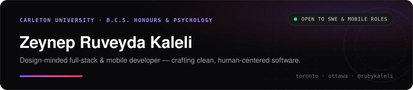

  <picture>
    <source media="(prefers-color-scheme: dark)" srcset="./assets/banner-dark.svg" />
    <source media="(prefers-color-scheme: light)" srcset="./assets/banner-light.svg" />
    
  </picture>

  
  
  
  

Final-year **B.C.S. (Honours) &amp; Minor in Psychology** student at **Carleton University** (`2022–Present`), building web and mobile software between **Toronto** and **Ottawa**. Interested in the overlap between UI/UX design, mobile engineering, and usable everyday tools.

Languages spoken: **English** (fluent) · **Turkish** (native) · **Greek** (conversational)

---

### Selected Projects

| Project | What It Does | Stack |
| :--- | :--- | :--- |
| **[portfolio2026](https://github.com/rubykaleli/portfolio2026)** · [Live](https://portfolio-zeta-bay-45.vercel.app/) | Personal site featuring interactive motion layouts and project case studies. | `Next.js` `TypeScript` `Tailwind` |
| **[mangaScraper](https://github.com/rubykaleli/mangaScraper)** | Zero-dependency Python CLI for sequential chapter image scraping and binary-header / file-size banner quarantine. | `Python` `urllib` `unittest` |
| **[WcPhoneLock](https://github.com/kalelimmehmet/WcPhoneLock)** *(Collaborator)* | iOS focus app combining `CoreLocation` geofencing, `CoreMotion` magnetometer &amp; barometer checks, and Screen Time shields. | `SwiftUI` `CoreMotion` `FamilyControls` |
| **Sillage** *(Concept)* | Full-stack fragrance discovery app with scent-note search, accord filtering, and personal wishlists. | `React Native` `Node.js` `PostgreSQL` |
| **T2S Audiobook Reader** | Local macOS/iOS reader and voice-cloning studio built on SwiftData, AVFoundation, and quantized Apple MLX synthesis. | `SwiftUI` `Apple MLX` `PDFKit` |

---

### Experience

- **Marketing Specialist · Wood City Design** *(2024–2025)* — Maintained the company website, standardized UI components across pages, and produced digital campaign assets.
- **IT Help Desk · The Learning Enrichment Foundation** *(2023)* — Supported AV and smartboard setups across 50+ weekly sessions, ran Zoom workshops, and automated spreadsheet reporting.

---

### Stack

<table>
  <tr>
    <td><strong>Languages</strong></td>
    <td><code>Python</code> <code>TypeScript</code> <code>JavaScript</code> <code>Swift</code> <code>Java</code> <code>SQL</code></td>
  </tr>
  <tr>
    <td><strong>Frontend &amp; Mobile</strong></td>
    <td><code>React</code> <code>Next.js</code> <code>React Native</code> <code>SwiftUI</code> <code>Tailwind CSS</code> <code>Framer Motion</code></td>
  </tr>
  <tr>
    <td><strong>Backend &amp; Data</strong></td>
    <td><code>Node.js</code> <code>PostgreSQL</code> <code>REST APIs</code> <code>SwiftData</code> <code>Apple MLX</code></td>
  </tr>
  <tr>
    <td><strong>Design &amp; Workflow</strong></td>
    <td><code>Figma</code> <code>Git</code> <code>XcodeGen</code> <code>Vercel</code></td>
  </tr>
</table>
